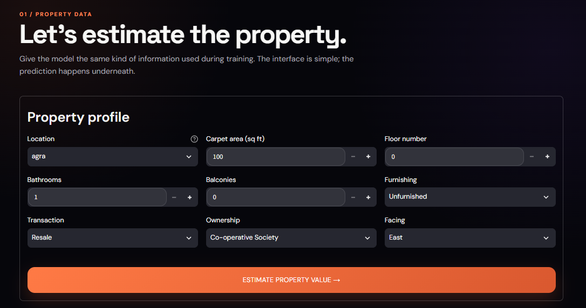
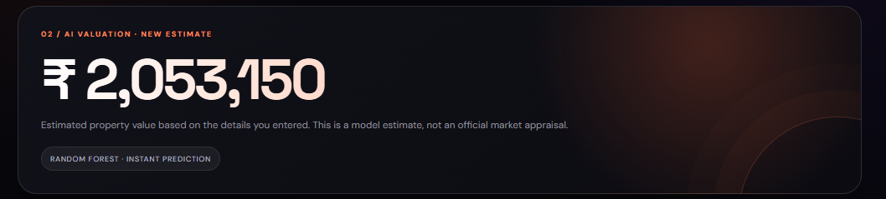

# 🏡 HOME_VALUE: Real Estate Price Prediction Web App


An end-to-end Machine Learning pipeline and interactive **Streamlit web application** that estimates residential property market values based on structural, spatial, and socio-economic features.

Developed as part of the **Information Technology Institute (ITI) AI & ML Foundation Program**.

---

## 📌 Features

- **Interactive Web UI**: Built with Streamlit to enable users to easily input property parameters and receive instant market estimations.
- **Data Preprocessing & Cleaning**: Automated handling of missing values, numerical conversion of area/price fields, outlier filtering, and categorical feature encoding.
- **Supervised Regression Modeling**: Utilizes a trained **Random Forest Regressor** trained on real-world property listings.
- **Comprehensive Feature Vector**: Evaluates property valuation based on 9 core attributes:
  - Location & Carpet Area (sqft)
  - Floor Number, Bathrooms, and Balconies
  - Furnishing Status & Facing Direction
  - Ownership & Transaction Type

---

## 🧠 Machine Learning Model

The project uses a **Random Forest Regressor** for house price prediction.

### Main Features

The model uses the following features:

- Carpet Area (sqft)
- Floor Number
- Bathroom
- Balcony
- Location
- Furnishing
- Transaction
- Ownership
- Facing

The dataset contains approximately **187,000 property listings** from the Indian real-estate market.

During preprocessing, property prices and area values are cleaned and converted into numerical values. Locations with lower frequencies are grouped into an `other` category, while selected categorical features are encoded for Machine Learning.

### Current Model Performance

The original model achieved:

| Metric | Value |
|---|---:|
| MAE | 1,354,452.18 |
| RMSE | 5,705,804.46 |
| R² Score | 0.8260 |

The model is being further improved through preprocessing and Random Forest hyperparameter tuning.

---

## 🛠️ System Architecture & Workflow

```text
┌────────────────────────┐     ┌───────────────────────────────────┐     ┌──────────────────────────────┐
│ Kaggle Real Estate     │ ──> │ Data Cleaning & Missing Value     │ ──> │ Feature Engineering &        │
│ Dataset (~187k Rows)   │     │ Imputation                        │     │ Categorical Encoding         │
└────────────────────────┘     └───────────────────────────────────┘     └──────────────────────────────┘
                                                                                        │
                                                                                        ▼
┌────────────────────────┐     ┌───────────────────────────────────┐     ┌──────────────────────────────┐
│ Streamlit Web App      │ <── │ Saved Serialized Model            │ <── │ Random Forest Regressor      │
│ (Interactive Inference)│     │ (`house_price.pkl`)               │     │ Training & Evaluation        │
└────────────────────────┘     └───────────────────────────────────┘     └──────────────────────────────┘
```


---


## 🌐 Web Application

The project includes an interactive **Streamlit** web application designed to provide a modern interface for house price prediction.

The website allows users to enter the required property information and obtain the predicted property value directly through the browser.

---

## 📸 Screenshots

### 🏠 Home Page


### 📝 Input Predictions



### 💰 The Predictive Value



---

## ⚙️ Tech Stack

- **Language:** Python 3.9+
- **Machine Learning:** scikit-learn
- **Data Processing & Analytics:** Pandas, NumPy
- **Web Interface:** Streamlit
- **Development & Tools:** Jupyter Notebook, Git, GitHub

---

## 🚀 How to Run the Website

### 1. Clone the Repository

```bash
git clone https://github.com/El-adghamF90/HOME_VALUE.git
```

Then move into the project folder:

```bash
cd HOME_VALUE
```

### 2. Install the Required Libraries

Make sure Python is installed on your computer.

Install the required dependencies:

```bash
pip install -r requirements.txt
```

If Streamlit is not already installed, install it using:

```bash
pip install streamlit
```

### 3. Run the Streamlit Website

From the **main project folder**, run:

```bash
streamlit run app.py
```

For example, on Windows:

```powershell
cd C:\Users\HP\HOME_VALUE  
streamlit run app.py
```

### 4. Open the Website

After running the command, Streamlit will start a local web server.

The terminal will normally display an address similar to:

```text
Local URL: http://localhost:8501
```

Open this address in your web browser:

```text
http://localhost:8501
```

The **HOME_VALUE** website will then be available locally.
---

## 📊 Dataset

**Dataset:** House Price by Juhi Bhojani

The project uses the [House Price dataset by Juhi Bhojani](https://www.kaggle.com/datasets/juhibhojani/house-price), which contains Indian residential property listings and their corresponding prices.

### Downloading the Dataset

The dataset can be obtained from Kaggle using either of the following methods.

### Option A — Download Manually

1. Open the [House Price dataset by Juhi Bhojani](https://www.kaggle.com/datasets/juhibhojani/house-price).
2. Click **Download** on the dataset page.
3. Unzip the downloaded file.
4. Place the CSV file inside:

```text
notebooks/data/
```

The expected location is:

```text
notebooks/data/house_prices.csv
```

### Option B — Kaggle CLI

Install the Kaggle CLI:

```bash
pip install kaggle
```

Then download and extract the dataset directly into the project:

```bash
kaggle datasets download -d juhibhojani/house-price -p notebooks/data --unzip
```

After downloading, make sure the CSV file is located inside:

```text
notebooks/data/
```

The notebook loads the dataset using:

```python
df = pd.read_csv("data/house_prices.csv")
```

when the notebook is run from the `notebooks/` directory.

---

## 🏡 How to Use the Website

1. Open the Streamlit website.
2. Click **START PREDICTION**.
3. Enter the property information.
4. Select the property location.
5. Enter the carpet area in square feet.
6. Select the floor number.
7. Enter the number of bathrooms.
8. Enter the number of balconies.
9. Select the furnishing status.
10. Select the transaction type.
11. Select the ownership type.
12. Select the property facing.
13. Submit the prediction.
14. The trained Machine Learning model will calculate and display the estimated property value.

---

## 📂 Project Structure

```text
HOME_VALUE/
│
├── app.py
│
├── backend/
│   ├── app/
│   │   ├── main.py
│   │   ├── preprocessing.py
│   │   └── locations.json
│   │
│   └── models/
│       └── house_price.pkl
│
├── notebooks/
│   ├── data/
│   │   └── house_prices.csv
│   │
│   └── house_price_model.ipynb
│
├── screenshots/
│   ├── Home_Page.png
│   ├── Input_Predictions.png
│   └── The_Predictive_Value.png
│
├── requirements.txt
│
└── README.md
```

---

## 🛠️ Technologies Used

- Python
- Pandas
- NumPy
- Scikit-learn
- Streamlit
- Random Forest
- Jupyter Notebook
- Git & GitHub

---

## 🔄 Machine Learning Workflow

```text
Dataset
   ↓
Data Cleaning
   ↓
Feature Extraction
   ↓
Handling Missing Values
   ↓
Outlier Filtering
   ↓
Feature Engineering
   ↓
Categorical Encoding
   ↓
Train / Test Split
   ↓
Random Forest Regression
   ↓
Model Evaluation
   ↓
Saved Model
   ↓
Streamlit Web Application
   ↓
House Price Prediction
```

---

---

## 📜 Certification & Context

Developed as part of the **AI & Machine Learning Foundation Level 1** program at the **Information Technology Institute (ITI)**, Knowledge City, New Capital, Cairo, Egypt.

---

## 👨‍💻 Author

**Mahmoud El-Adgham**  
Electrical & Electronic Engineering | AI & Machine Learning  

* **GitHub:** [El-adghamF90](https://github.com/El-adghamF90)
* **LinkedIn:** [Mahmoud EL-Adgham](https://www.linkedin.com/in/mahmoud-el-adgham/)
